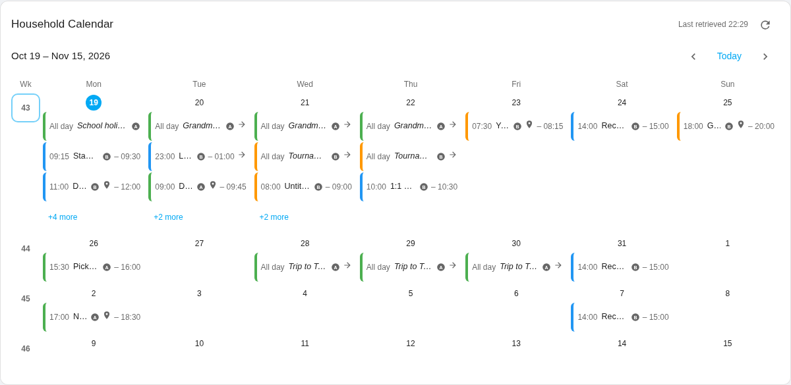
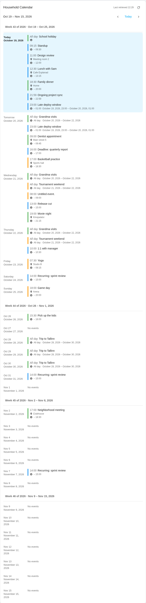
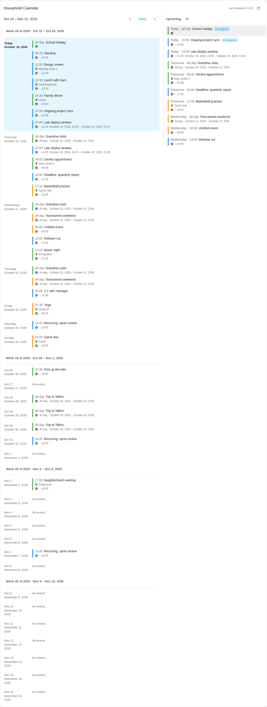
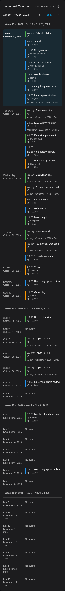

# Calendar Week Card

A compact Home Assistant dashboard card that combines multiple `calendar.*`
entities into:

- a **multiweek calendar grid** (with optional ISO week numbers),
- a **responsive calendar agenda** for narrow dashboards,
- a **chronological upcoming-events list**,
- and **both views together** — stacked or side by side.

The card is **read-only** and **frontend-only**. ICS feeds are handled by Home
Assistant's built-in [Remote Calendar](https://www.home-assistant.io/integrations/remote_calendar/)
integration (or any other calendar integration); the card reads events through
the authenticated Home Assistant calendar API. It never downloads ICS files,
parses feeds, expands recurrences, or sends data anywhere.

| Grid (desktop) | Agenda (tablet) |
| --- | --- |
|  |  |

| Side by side (desktop) | Dark theme (mobile) |
| --- | --- |
|  |  |

---

## 1. Installation with HACS (custom repository)

1. In HACS, go to **Dashboard** (this category is called *Plugin* in older
   versions) → the three dots → **Custom repositories**.
2. Add `https://github.com/juahan/ha-super-calendar-card` with category
   **Dashboard**.
3. Install **Calendar Week Card** and restart Home Assistant.
4. Register the resource (see [§3](#3-resource-registration-and-troubleshooting))
   if HACS did not do it automatically.
5. Add the card to a dashboard (see [§5](#5-selecting-calendar-entities-in-the-card)).

### Updates

HACS offers updates like any other Dashboard plugin. Because the compiled
bundle is committed to `dist/` on the default branch, updates also work without
a GitHub release. When releases exist, HACS installs from the latest release
asset.

### Resource URL produced by HACS

HACS serves downloaded plugin files from `/hacsfiles/<repository>/<file>`.
Depending on how HACS resolves the file name, the resource will be either:

```text
/hacsfiles/ha-super-calendar-card/calendar-week-card.js     (hacs.json "filename")
```

or

```text
/hacsfiles/ha-super-calendar-card/ha-super-calendar-card.js (repository-name match)
```

Both files are shipped in `dist/` and are byte-identical; either URL works.
Use the URL HACS actually registers and keep the type **JavaScript module**.

## 2. Manual installation

1. Download [`dist/calendar-week-card.js`](dist/calendar-week-card.js) from
   this repository.
2. Copy it to the `www/` folder of your Home Assistant configuration
   directory (create the folder if needed), so the file is served as
   `/local/calendar-week-card.js`.
3. Go to **Settings → Dashboards → ⋮ → Resources → Add resource**:
   - URL: `/local/calendar-week-card.js`
   - Type: **JavaScript module**
4. Reload the browser page and add a manual card with
   `type: custom:calendar-week-card`.

## 3. Resource registration and troubleshooting

- **"Custom element doesn't exist: calendar-week-card"** — the resource is not
  registered, points at the wrong URL, or has the wrong type. Check
  **Settings → Dashboards → Resources** for an entry of type **JavaScript
  module** whose URL returns the file (open the URL directly in the browser —
  you should see JavaScript, not a 404).
- **Card appears in the picker but shows a configuration error** — the error
  message names the exact problem (for example a missing `sources` list or a
  duplicate entity). Fix the YAML accordingly.
- **Hard refresh** (`Ctrl+F5` / `Cmd+Shift+R`) after updates; browsers cache
  module resources aggressively.
- **Dark/light theme looks wrong** — the card follows Home Assistant's theme
  variables (`--ha-card-background`, `--primary-color`, …). Custom themes that
  do not define them fall back to the system color scheme.

## 4. Adding ICS feeds with Remote Calendar

The card accepts **`calendar.*` entities only** — it does not accept URLs.

1. In Home Assistant: **Settings → Devices & services → Add integration →
   Remote Calendar** (or use the *My Home Assistant* button on the
   [Remote Calendar page](https://www.home-assistant.io/integrations/remote_calendar/)).
2. Give the calendar a name and paste the ICS feed URL. If the feed needs
   authentication, Remote Calendar prompts for a username and password
   (HTTP Basic Authentication).
3. The integration creates a `calendar.<name>` entity. Add that entity to the
   card as a source.

Remote Calendar downloads and parses the feed itself, **on its own schedule**
(once every 24 hours by default — see [§8](#8-remote-calendar-refresh-pacing)).
Any Home Assistant calendar integration works the same way; Remote Calendar is
simply the one that accepts raw ICS URLs.

### Authentication limitations of Remote Calendar

- Only **HTTP Basic Authentication** is supported. Feeds that require special
  headers, token query parameters, cookies, or OAuth cannot be used directly.
- Feed access is read-only. Canceled events are removed from the calendar by
  the integration.

## 5. Selecting calendar entities in the card

Add a manual card or use the visual editor. Minimum YAML:

```yaml
type: custom:calendar-week-card
sources:
  - id: family
    entity: calendar.family
```

In the visual editor every source row has a **Calendar entity** dropdown that
lists only `calendar.*` entities, plus name, color, icon and reorder controls
and a **Test connection** button (an empty successful response counts as a
valid connection).

Entity states like "next event" are never used — the card always retrieves
occurrences from the calendar API, so everything the entity's API returns is
shown, not just the next event.

## 6. Configuration reference

All settings and their defaults (omitted sections fall back to these; the
supplied configuration object is never modified):

| Option | Values | Default |
| --- | --- | --- |
| `title` | string; empty hides the title | `Calendar` |
| `view` | `calendar`, `upcoming`, `combined` | `combined` |
| `combined_layout` | `calendar_top`, `list_top`, `side_by_side` | `calendar_top` |
| `timezone` | `home_assistant` or valid IANA timezone | `home_assistant` |
| `time_format` | `auto`, `12`, `24` | `auto` |
| `show_source_icons` | boolean | `true` |
| `show_source_names` | boolean | `false` |
| `show_location` | boolean | `false` |
| `show_end_time` | boolean | `false` |
| `calendar.layout` | `auto`, `grid`, `agenda` | `auto` |
| `calendar.weeks_to_show` | integer 1–12 | `4` |
| `calendar.first_day_of_week` | `monday`, `sunday` | `monday` |
| `calendar.show_week_numbers` | boolean | `true` |
| `calendar.highlight_current_week` | boolean | `true` |
| `calendar.highlight_today` | boolean | `true` |
| `calendar.show_empty_days` | boolean | `true` |
| `calendar.max_events_per_day` | integer 1–20 | `3` |
| `upcoming.max_events` | integer 1–50 | `10` |
| `upcoming.lookahead_days` | integer 1–366 | `90` |
| `upcoming.date_format` | `relative`, `absolute` | `relative` |
| `upcoming.include_ongoing` | boolean | `true` |
| `upcoming.follow_selected_week` | boolean | `false` |

### Sources

```yaml
sources:
  - id: family            # required, unique, stable (kept across renames/reorders)
    entity: calendar.family  # required, must start with calendar.
    name: Family          # optional; defaults to the entity friendly name, then entity ID
    color: "#4CAF50"      # optional six-digit hex; otherwise a deterministic palette color
    icon: mdi:account-group  # optional; defaults to mdi:calendar
```

Rules:

- `sources` is required and must be nonempty.
- No URLs — only `calendar.*` entity IDs.
- Duplicate entity IDs and duplicate source IDs are rejected with an
  actionable configuration error.
- A missing or unavailable entity is a **runtime source error** shown in the
  card; other sources keep working.

### Behavior of the main options

- `calendar.layout: auto` uses the grid when the calendar panel is at least
  **840 CSS px** wide, otherwise the agenda. `grid` keeps a horizontally
  scrollable grid in narrow containers; `agenda` always shows the agenda. The
  agenda covers exactly the same dates as the grid.
- `combined_layout: side_by_side` splits the card ~60% calendar / 40% list and
  stacks (calendar on top) below **1100 CSS px** of *card* width.
- `upcoming.lookahead_days` bounds the upcoming list: the list shows the next
  `upcoming.max_events` occurrences from now until the same local time
  `lookahead_days` calendar days ahead — it never stretches the range to fill
  the list. The horizon is independent of the displayed calendar weeks.
- `upcoming.follow_selected_week: true` (combined view) filters the list to the
  week you select in the calendar and changes the list heading to that week;
  "Show all N events" and "Clear week selection" buttons appear as needed.
  With `false`, selecting a week only highlights it (in calendar-only view it
  also opens a week events dialog).
- `upcoming.include_ongoing: false` omits timed events that have already
  started and all-day events whose start date is before today (today's all-day
  events are kept).
- `timezone: home_assistant` uses Home Assistant's configured timezone — the
  browser timezone is never used silently. Week/day boundaries, relative dates
  ("Today", "Tomorrow") and ongoing-event detection all use this timezone.
- `time_format: auto` follows the Home Assistant user profile setting.

## 7. Examples for all five arrangements

**Calendar only**

```yaml
type: custom:calendar-week-card
view: calendar
title: Family schedule
sources:
  - id: family
    entity: calendar.family
```

**Upcoming list only**

```yaml
type: custom:calendar-week-card
view: upcoming
title: Coming up
upcoming:
  max_events: 5
  lookahead_days: 14
  date_format: relative
sources:
  - id: family
    entity: calendar.family
```

**Combined — calendar above list** (default)

```yaml
type: custom:calendar-week-card
view: combined
combined_layout: calendar_top
sources:
  - id: family
    entity: calendar.family
  - id: work
    entity: calendar.work
```

**Combined — list above calendar**

```yaml
type: custom:calendar-week-card
view: combined
combined_layout: list_top
upcoming:
  max_events: 5
sources:
  - id: family
    entity: calendar.family
```

**Combined — calendar and list side by side** (stacks below 1100 px)

```yaml
type: custom:calendar-week-card
view: combined
combined_layout: side_by_side
calendar:
  weeks_to_show: 2
upcoming:
  follow_selected_week: true
sources:
  - id: family
    entity: calendar.family
  - id: work
    entity: calendar.work
```

## 8. Remote Calendar refresh pacing

**Two different refreshes exist — do not confuse them:**

| What | When | Trigger |
| --- | --- | --- |
| **Upstream ICS feed → Home Assistant** | every 24 h by default | Remote Calendar integration |
| **Home Assistant → this card** | every 5 min while visible | the card's own polling |

The card's refresh button and 5-minute polling **only re-read the events Home
Assistant already has**. They do not download the original ICS feed and the
card never calls `homeassistant.update_entity`.

To make Remote Calendar re-download its feed every 15 minutes (optional), use
the [documented custom-polling approach](https://www.home-assistant.io/integrations/remote_calendar/#defining-a-custom-polling-interval):

1. Open the Remote Calendar integration entry → **⋮ → System options** and
   disable polling.
2. Create an automation like:

```yaml
automation:
  - alias: "Refresh remote calendars every 15 minutes"
    triggers:
      - trigger: time_pattern
        minutes: "/15"
    actions:
      - action: homeassistant.update_entity
        target:
          entity_id:
            - calendar.family
            - calendar.work
```

(`homeassistant.update_entity` supports targeting by entity only and debounces
at 10 seconds.)

## 9. What "Last retrieved" means

The card shows **"Last retrieved HH:MM"** — the time of the card's last
successful Home Assistant API request. It is deliberately *not* labelled
"Last ICS sync": the card cannot know when Remote Calendar last downloaded the
feed. A successful API request also does not prove the upstream feed is fresh.

## 10. Timezones, all-day events, failures and stale data

- **Timezones** — all-day events are kept as dates; timed events are shown in
  the display timezone. Events at DST transitions are handled with calendar
  arithmetic (no fixed 24-hour additions).
- **All-day events** — the API's end date is exclusive; the card shows
  multi-day all-day events on every day they cover and never on the exclusive
  end date. Occurrences ending at midnight do not spill into the next day.
- **Multi-day events** — shown once per day in the grid/agenda and once in the
  upcoming list.
- **Source failures** — each source is requested independently. A failing
  source is named in a warning banner ("Some calendars could not be loaded:
  …") and a **Retry** button is offered; the other sources render normally.
- **Stale results** — if a refresh fails after earlier data was loaded, the
  earlier data is kept and marked stale (the banner appears). Days are never
  labelled definitively "empty" while a source request is failing.
- **Malformed events** are skipped with a console warning instead of breaking
  the card.

## 11. Supported and tested Home Assistant versions

- The card uses only the stable custom-card interface
  (`setConfig`, `hass`, `getCardSize`, `getGridOptions`, visual editor with
  `config-changed`) and `hass.callApi("GET", "calendars/…")` as documented for
  current Home Assistant (documentation verified against the 2026.10 release
  of the developer docs and the Remote Calendar integration page).
- Remote Calendar itself requires **Home Assistant 2025.4 or newer**.
- **Honest status:** this repository's automated tests run against mock API
  responses and a fixture preview; no live Home Assistant or HACS installation
  was available during development. See
  [IMPLEMENTATION_STATUS.md](IMPLEMENTATION_STATUS.md) for the exact list of
  unverified manual checks.

## 12. Local preview

A fixture-based preview (no Home Assistant needed):

```bash
npm ci
npm run build
node demo/serve.mjs
# open http://127.0.0.1:4173/demo/index.html
```

`npm run dev` rebuilds on change and serves the same preview. The preview page
lets you switch arrangements, calendar layout, viewport width (375/768/1200),
light/dark theme, and simulate a failing source. All events are local fixtures
served by `demo/mock-hass.js` through the same API shape the card uses in
production — they are never shown as fallback data in a real dashboard.

## Development

```bash
npm ci
npm run lint
npm run typecheck
npm run test        # Vitest unit tests
npm run test:e2e    # Playwright browser tests (builds the bundle first)
npm run build       # dist/calendar-week-card.js (+ alias)
npm run screenshots # regenerate screenshots/ from the preview
```

Node.js 22 LTS is used (see `.nvmrc`). The production bundle is a single ES
module with Lit and Luxon compiled in — no CDNs, no code splitting, no
external fonts or icon fonts.

Architecture: `src/config.ts` (validation/defaults), `src/dates.ts` (pure date
logic), `src/events.ts` (normalization/sorting/selection), `src/ranges.ts`
(range planning), `src/api.ts` + `src/cache.ts` (retrieval and caching),
`src/views/` (presentation), `src/editor.ts` (visual editor).

## Privacy

The card runs entirely in the browser inside your Home Assistant session. It
makes requests only to your Home Assistant instance and talks to no external
services.

## License

[MIT](LICENSE)
